# Money Ghosts — A Subscription Leak & Financial Déjà Vu Detector

**DBMS Experiential Learning – Level 3 Project** · PES University
**Team:** Apeksha Ashok (PES1UG24AM048) · Avanthika J (PES1UG24AM059)
**Stack:** PostgreSQL 16 + pgvector · MongoDB 7 · Next.js 14

---

## 1. Problem statement

People lose money every month to recurring charges they no longer track: forgotten subscriptions, quiet price increases, and the same service paid for twice by two people in one household. Bank statements show these charges as cryptic lines such as `POS 4821XXXXXXXX1234 NETFLIX.COM 552910`, and every bank uses a different file layout. That makes the patterns hard to spot by hand, and most budgeting apps need manual tagging that people give up on.

## 2. Objectives

1. Detect recurring (subscription-like) charges from raw transaction data without manual tagging.
2. Identify price creep and dormant subscriptions, and surface double charges and household duplicates.
3. Allow natural-language search over cryptic transaction descriptions.
4. Support shared household accounts so linked users can track and split recurring costs.
5. Use a justified multi-paradigm design: relational, vector and document databases.

## 3. Scope

**In scope:**

- Register and log in.
- Multiple accounts per user, and sharing them with read-only or contributor access.
- Import of CSV and JSON statements, with the bank format detected automatically.
- Leak detection with alerts, and a 30-day forecast.
- Semantic and keyword search.
- Automatic categories, cost splits and budgets.

**Out of scope:**

- Live bank API integration.
- Payment processing.
- Credits and income: imports keep only debits.

## 4. Functional requirements

| ID | Requirement | Where |
|---|---|---|
| FR1 | Register / log in; passwords stored as bcrypt hashes | `/register`, `/login` |
| FR2 | Roles: **Individual user** (account owner) and **Shared/Family member** (contributor or read-only) | `user_access_level()`, `lib/api.js` |
| FR3 | Create accounts; share an account by e-mail with read-only or contributor access | `/household` |
| FR4 | Import a CSV/JSON statement; raw file kept in MongoDB; same file cannot be imported twice | `/import` |
| FR5 | Detect recurring charges (weekly / monthly / quarterly / yearly) and mark them active or dormant | `detect_subscriptions()` |
| FR6 | Log price increases and show alerts | trigger `subscription_price_change` |
| FR7 | Show double charges and household duplicates | views `duplicate_charges`, `household_duplicate_subscriptions` |
| FR8 | Show charges expected in the next 30 days | recursive `forecast_charges()` |
| FR9 | List, filter, page, re-categorise and delete transactions | `/transactions` |
| FR10 | Search by meaning (vector) or by keyword (full-text) | `/search` |
| FR11 | Split a subscription's cost between household members | `set_split()` |
| FR12 | Monthly budgets per category | `/budgets`, view `budget_status` |

## 5. Database choice and justification

| Data | Database | Why |
|---|---|---|
| Users, accounts, sharing, transactions, subscriptions, price history, splits, budgets | **PostgreSQL** | Highly connected data with strict rules: foreign keys, CHECK constraints, unique rules, transactions, and SQL analytics (window functions, recursive queries). |
| Meaning of merchant descriptions | **pgvector** | Descriptions are short codes; keyword search can't connect "video streaming" to `NETFLIX.COM`, but embeddings can. Vectors sit next to the rows, so one SQL query combines similarity with joins and access control. |
| Raw uploaded statements, bank-format profiles | **MongoDB** | Each bank names its columns differently, and some exports are nested JSON. The raw file is stored as-is, so nothing is lost and the SQL schema never changes for a new bank. |

## 6. ER diagram

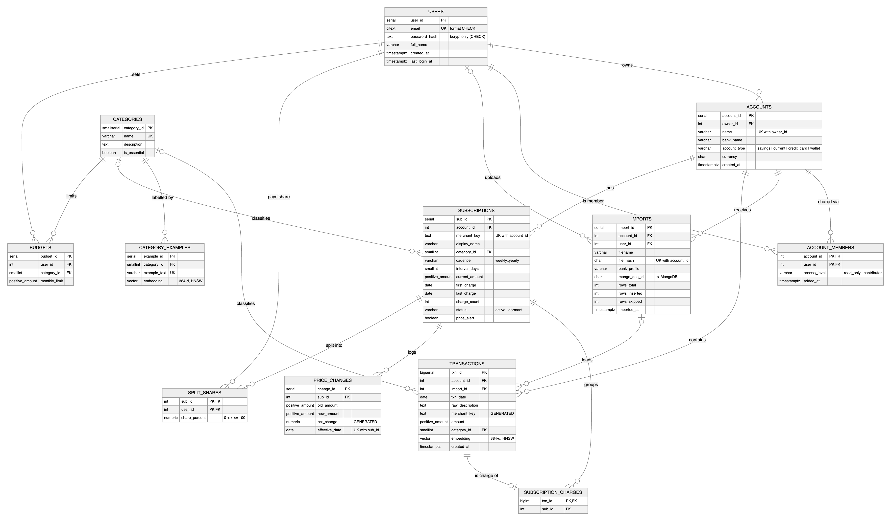

**Relationships:**

- USERS 1–N ACCOUNTS (owns)
- USERS M–N ACCOUNTS through ACCOUNT_MEMBERS (shared, with `access_level`)
- ACCOUNTS 1–N IMPORTS 1–N TRANSACTIONS
- CATEGORIES 1–N TRANSACTIONS / SUBSCRIPTIONS / BUDGETS / CATEGORY_EXAMPLES
- ACCOUNTS 1–N SUBSCRIPTIONS
- SUBSCRIPTIONS 1–N TRANSACTIONS through SUBSCRIPTION_CHARGES
- SUBSCRIPTIONS 1–N PRICE_CHANGES
- SUBSCRIPTIONS M–N USERS through SPLIT_SHARES (`share_percent`)
- USERS 1–N BUDGETS

## 7. Relational schema

Primary keys are in **bold**; foreign keys are marked †.

- USERS(**user_id**, email UNIQUE, password_hash, full_name, created_at, last_login_at)
- ACCOUNTS(**account_id**, owner_id† → USERS, name, bank_name, account_type, currency, created_at); UNIQUE(owner_id, name)
- ACCOUNT_MEMBERS(**account_id**†, **user_id**†, access_level, added_at)
- CATEGORIES(**category_id**, name UNIQUE, description, is_essential)
- CATEGORY_EXAMPLES(**example_id**, category_id†, example_text UNIQUE, embedding vector(384))
- IMPORTS(**import_id**, account_id†, user_id†, filename, file_hash, bank_profile, mongo_doc_id, rows_total, rows_inserted, rows_skipped, imported_at); UNIQUE(account_id, file_hash)
- TRANSACTIONS(**txn_id**, account_id†, import_id†, txn_date, raw_description, merchant_key GENERATED, amount, category_id†, embedding vector(384), created_at); UNIQUE(account_id, txn_date, raw_description, amount)
- SUBSCRIPTIONS(**sub_id**, account_id†, merchant_key, display_name, category_id†, cadence, interval_days, current_amount, first_charge, last_charge, charge_count, status, price_alert, detected_at); UNIQUE(account_id, merchant_key)
- SUBSCRIPTION_CHARGES(**txn_id**†, sub_id†)
- PRICE_CHANGES(**change_id**, sub_id†, old_amount, new_amount, pct_change GENERATED, effective_date, detected_at); UNIQUE(sub_id, effective_date)
- SPLIT_SHARES(**sub_id**†, **user_id**†, share_percent)
- BUDGETS(**budget_id**, user_id†, category_id†, monthly_limit); UNIQUE(user_id, category_id)

All tables are in 3NF.

**Constraints at database level:**

- The `positive_amount` domain (> 0) is used for every money column.
- E-mail format CHECK on a case-insensitive CITEXT column.
- `password_hash` must be a bcrypt hash, so plain text is rejected.
- `txn_date` must be between 2000 and tomorrow.
- `status`, `cadence` and `access_level` are limited to fixed value sets.
- `share_percent` must be in (0, 100].
- Foreign keys use CASCADE or SET NULL as appropriate.
- Triggers enforce the rules a CHECK can't express (section 9).

The full data dictionary is in [DATA_DICTIONARY.md](DATA_DICTIONARY.md).

## 8. MongoDB data model

**`raw_statements`**: one document per uploaded file, stored exactly as received.

```json
{ "_id": ObjectId("…"), "user_id": 1, "account_id": 3, "filename": "paytm_wallet.json",
  "file_hash": "9f2c…", "format": "json", "bank_profile": "paytm_wallet_json", "row_count": 345,
  "records": [ { "postedOn": "2026-05-04T10:22:00+05:30", "direction": "DEBIT",
                 "merchant": { "name": "THE HINDU EPAPER" }, "amount": { "value": 30 } } ],
  "status": "imported", "import_id": 3, "result": { "inserted": 326, "credits": 19, "invalid": 0 },
  "uploaded_at": ISODate("…") }
```

- **Validation:** a `$jsonSchema` validator checks the required fields, `format ∈ {csv, json}`, `status`, and the `file_hash` pattern.
- **Indexes:** `{user_id, uploaded_at}`, and a unique `{account_id, file_hash}` index with a partial filter on `{active: true}`.
- **Link to PostgreSQL:** `imports.mongo_doc_id` stores the document's `_id`.

**`bank_profiles`**: one document per statement format. Six are seeded: generic CSV, generic JSON, HDFC, ICICI card, SBI, and the Paytm wallet (nested JSON).

```json
{ "code": "icici_card_csv", "bank": "ICICI Bank (credit card)", "format": "csv",
  "match_headers": ["Transaction Date", "Details", "Amount (INR)", "Type"],
  "columns": { "date": "Transaction Date", "description": "Details", "amount": "Amount (INR)", "direction": "Type" },
  "debit_values": ["Dr"], "date_format": "DD-MM-YYYY" }
```

It is validated by `$jsonSchema` and has a unique index on `code`.

**Aggregation:** the import page groups `raw_statements` by format with `$match` → `$group` → `$sort`.

## 9. SQL implementation

The SQL files are in `database/`:

- [01_schema.sql](../database/01_schema.sql): CREATE, ALTER and DROP, keys, constraints, a domain, generated columns, and indexes.
- [02_functions_triggers.sql](../database/02_functions_triggers.sql): functions and triggers.
- [03_views.sql](../database/03_views.sql): views.
- [04_reference_data.sql](../database/04_reference_data.sql): categories and example merchants.
- [05_demo_queries.sql](../database/05_demo_queries.sql): demo queries, with output in [demo-queries-output.txt](demo-queries-output.txt).

### Advanced database features

| Feature | Implementation |
|---|---|
| **Stored function** | `detect_subscriptions(account)` is the leak-detection engine (see below). |
| **Window functions** | `LAG()` for gaps and price changes, `STDDEV_SAMP`, `MODE()`; the `duplicate_charges` view |
| **Recursive query** | `forecast_charges(account, days)` uses `WITH RECURSIVE` to build the upcoming-charge schedule |
| **Triggers** | `subscription_price_change` (log and flag price rises), `account_member_not_owner`, `split_share_needs_access`, `transaction_autocategorize` (vector nearest neighbour) |
| **Transactions** | Each import is one `BEGIN … COMMIT` (rows plus detection; rollback on error). `set_split()` is all-or-nothing. Registration creates the user and the first account atomically. |
| **Views** | `user_accounts`, `monthly_summary`, `category_monthly_spend`, `subscription_overview`, `subscription_cost_view`, `duplicate_charges`, `household_duplicate_subscriptions`, `budget_status` |
| **Indexing** | Composite B-tree, a partial index, GIN full-text, GIN trigram, and HNSW vector indexes; MongoDB compound and partial-unique indexes |
| **Full-text search** | `to_tsvector … @@ plainto_tsquery` (keyword search) |
| **Vector similarity search** | pgvector cosine distance `<=>` |
| **NoSQL aggregation** | MongoDB `$group` pipeline on `raw_statements` |

**How `detect_subscriptions(account)` works:**

1. `LAG()` gives the gap in days between consecutive charges of the same merchant.
2. A merchant counts as recurring when all three hold:
   - the average gap matches a cadence (weekly, monthly, quarterly or yearly);
   - the gaps are regular (small standard deviation);
   - the amount takes only a few values.
3. Results are upserted into `subscriptions`. A changed amount fires the price-change trigger.
4. Charges are linked in `subscription_charges`.
5. Price history is rebuilt with `LAG(amount)`.
6. A subscription whose next expected charge is overdue is marked `dormant`.

### Important queries

**Window function (core of leak detection):**

```sql
SELECT merchant_key, txn_date, amount,
       txn_date - LAG(txn_date) OVER (PARTITION BY merchant_key ORDER BY txn_date) AS gap
FROM transactions WHERE account_id = $1;
```

**Recursive forecast:**

```sql
WITH RECURSIVE schedule AS (
  SELECT sub_id, display_name, cadence, next_due(last_charge, cadence) AS due_date, current_amount AS amount
  FROM subscriptions WHERE account_id = $1 AND status = 'active'
  UNION ALL
  SELECT sub_id, display_name, cadence, next_due(due_date, cadence), amount
  FROM schedule WHERE next_due(due_date, cadence) <= CURRENT_DATE + $2)
SELECT * FROM schedule WHERE due_date BETWEEN CURRENT_DATE AND CURRENT_DATE + $2 ORDER BY due_date;
```

**JOIN + GROUP BY + HAVING (category totals on the dashboard):**

```sql
SELECT category, SUM(total_spend) AS total FROM category_monthly_spend
WHERE account_id = $1 AND month >= date_trunc('month', CURRENT_DATE) - INTERVAL '2 months'
GROUP BY category HAVING SUM(total_spend) > 0 ORDER BY total DESC;
```

**Self-join + subqueries (household duplicates the viewer can see):**

```sql
SELECT d.display_name, a1.name, a2.name FROM household_duplicate_subscriptions d
JOIN accounts a1 ON a1.account_id = d.account_id JOIN accounts a2 ON a2.account_id = d.other_account_id
WHERE d.account_id       IN (SELECT account_id FROM user_accounts WHERE user_id = $1)
  AND d.other_account_id IN (SELECT account_id FROM user_accounts WHERE user_id = $1);
```

**DML in the application:**

- **INSERT:** import, budgets, sharing, splits.
- **UPDATE:** re-categorise a transaction, sharing level.
- **DELETE:** transactions, budgets, members.
- **SELECT:** every page.

## 10. Vector search

| Question | Answer |
|---|---|
| What is embedded? | Each transaction's cleaned merchant name from `normalize_merchant()` (e.g. `POS 4821XXXX NETFLIX.COM 552910` → `netflix`), 90 labelled example merchants, and the search query. |
| Model | `all-MiniLM-L6-v2`, run locally with `@xenova/transformers`; 384 dimensions, normalised. |
| Storage | pgvector `vector(384)` columns in `transactions` and `category_examples`, with HNSW indexes (`vector_cosine_ops`). |
| Similarity metric | Cosine distance `<=>` (similarity = 1 − distance). |
| Retrieval | Score = max(similarity to the merchant, 0.9 × similarity of the query to the transaction's category examples). Results are grouped by merchant; the top 10 with score ≥ 0.30 are shown. |
| Categorisation | The `transaction_autocategorize` trigger gives each new transaction the category of the nearest example merchant, or "Other" below 0.40. |

**Example:** "video streaming" finds Netflix, YouTube Premium, Prime and Hotstar. A keyword search for the same text finds nothing.

## 11. System architecture

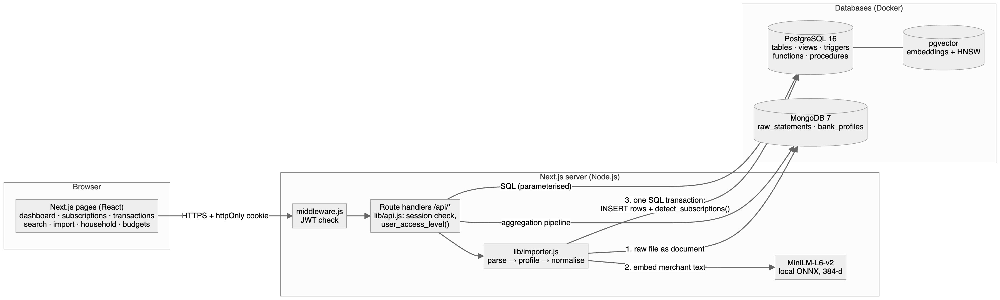

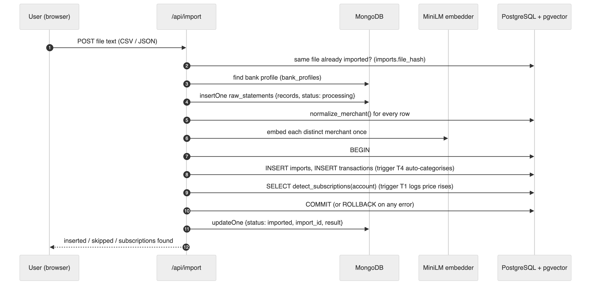

- **Frontend:** Next.js pages.
- **Backend:** Next.js API route handlers (`app/api`). Each one checks the session and asks PostgreSQL `user_access_level()` before touching an account.
- **Configuration:** all credentials come from `.env.local` environment variables.

## 12. Authentication, authorisation and security

| Role | Can |
|---|---|
| **Individual user** (owner) | everything on their own accounts, including sharing them |
| **Shared member – contributor** | import, re-categorise and delete transactions, change splits |
| **Shared member – read-only** | view only |

**Security measures:**

- Passwords are hashed with bcrypt (also enforced by a CHECK constraint).
- Sessions use a signed JWT in an httpOnly cookie.
- All SQL is parameterised.
- Secrets live only in the git-ignored `.env.local`.

## 13. Application screenshots

| | |
|---|---|
| 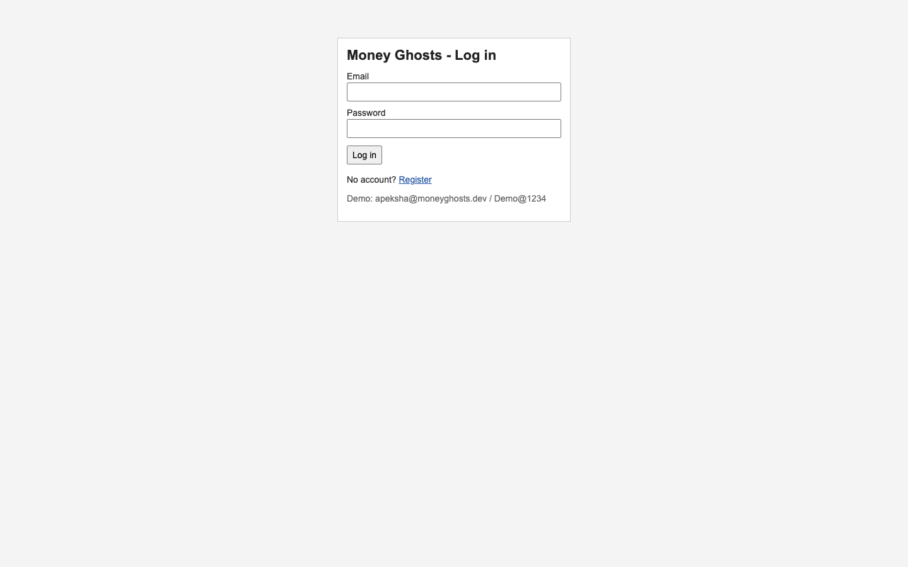 Login | 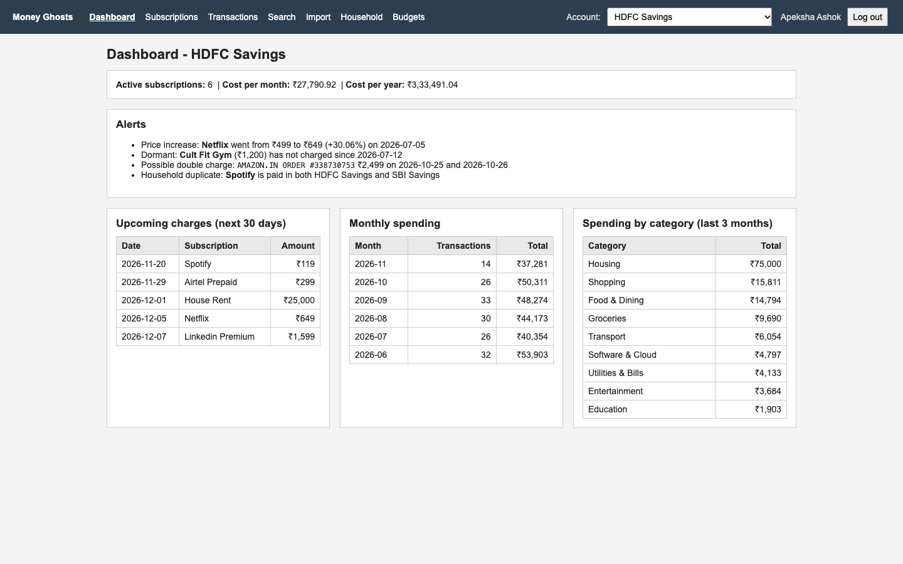 Dashboard |
| 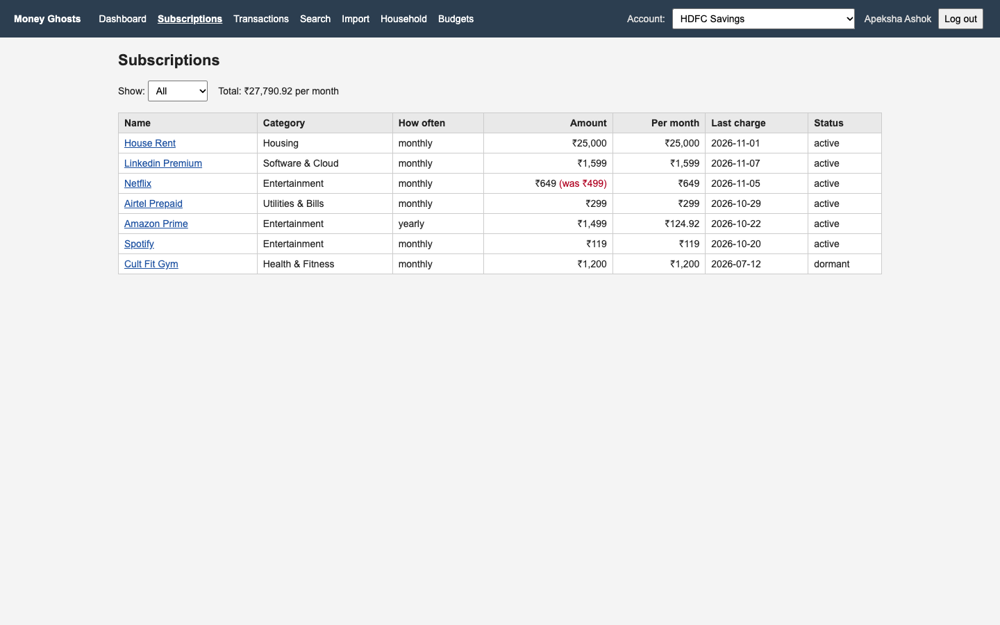 Subscriptions | 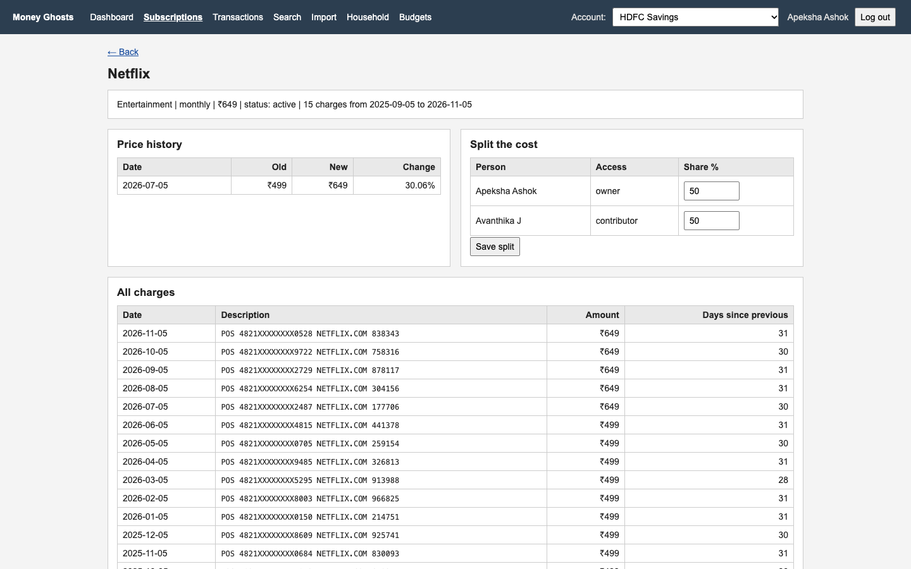 Subscription detail and split |
| 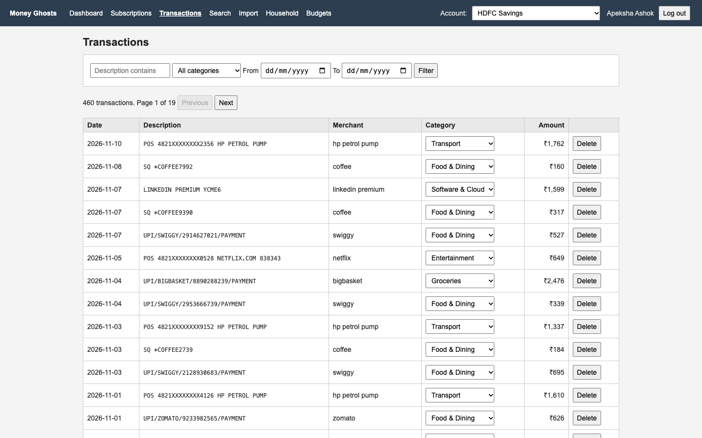 Transactions | 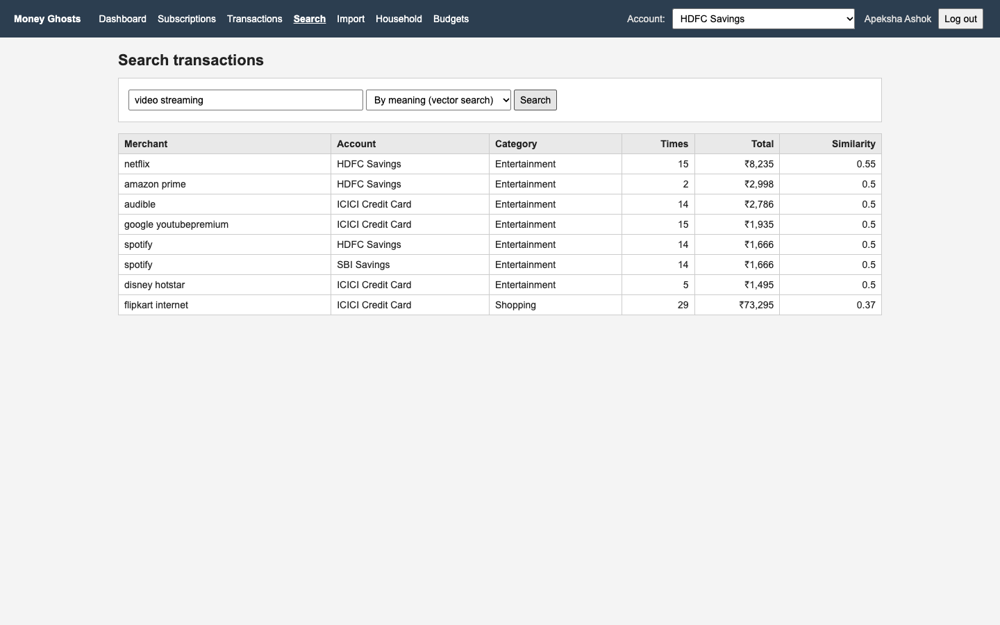 Search by meaning |
| 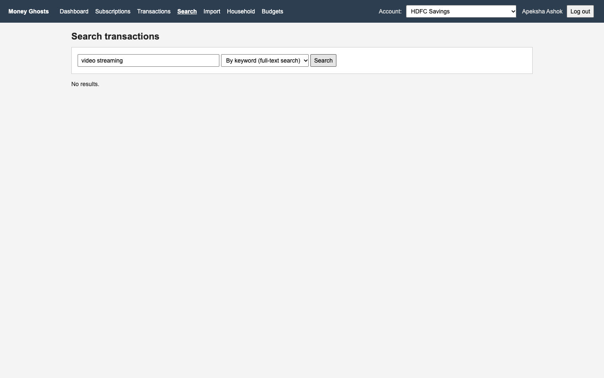 Keyword search (no results) | 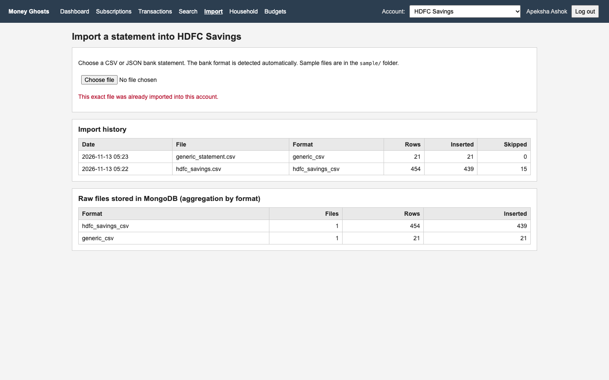 Import |
| 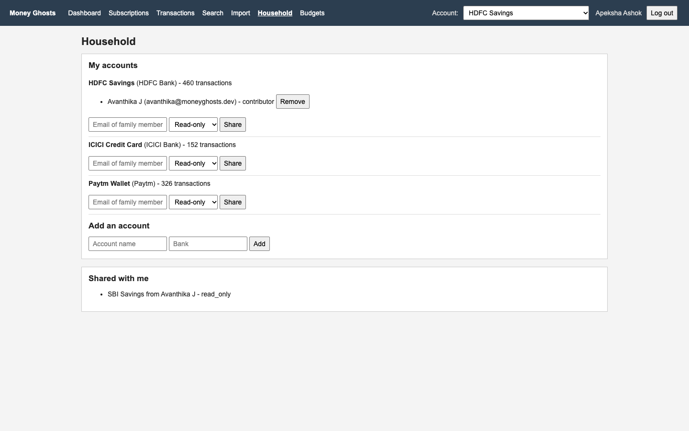 Household sharing | 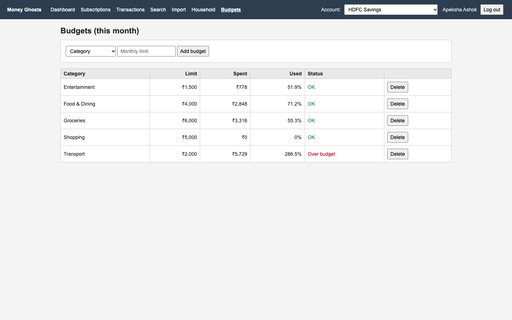 Budgets |
| 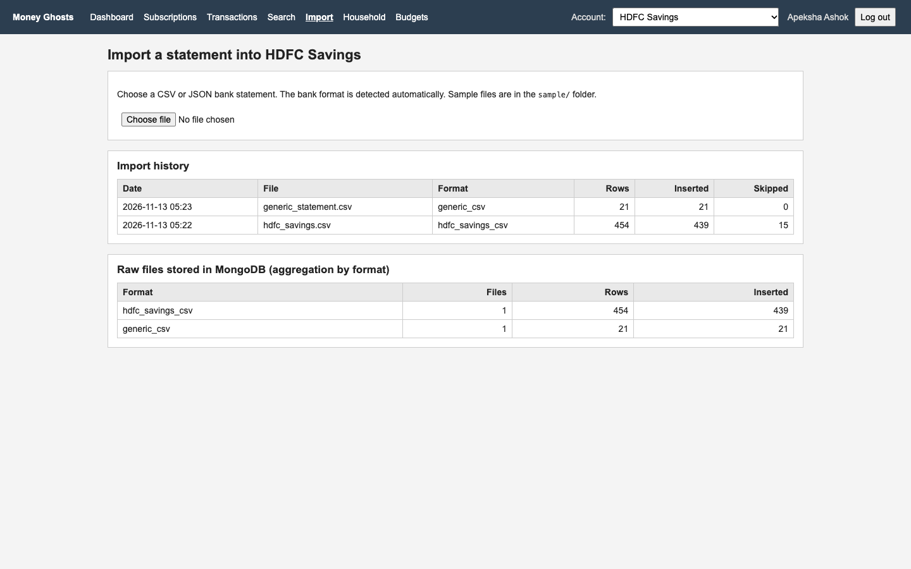 Read-only member cannot import | 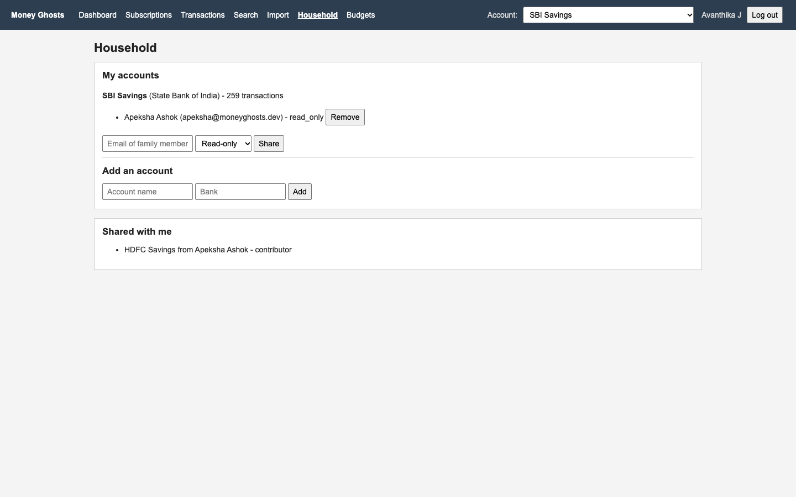 Shared member's view |

## 14. Testing

27 automated tests: 5 parser, 13 database and 9 API. **All 27 pass.** Details are in [TEST_RESULTS.md](TEST_RESULTS.md).

## 15. Conclusion and future enhancements

Money Ghosts turns messy bank statements into a list of recurring charges, with alerts for price rises, dormant subscriptions, double charges and household duplicates, and no manual tagging. Each database does the job it suits:

- **PostgreSQL** stores the connected financial data and runs the detection logic.
- **pgvector** makes cryptic merchant codes searchable by meaning.
- **MongoDB** keeps each bank's raw format without changing the SQL schema.

**Future enhancements:**

- Bank API integration instead of file upload.
- Notifications before upcoming charges.
- Settling split costs between members.
- Support for more bank formats and currencies.

## 16. Team contributions

> This split is a proposal. Adjust it to what each of you actually did.

| Area | Apeksha Ashok | Avanthika J |
|---|---|---|
| Database | ER model, schema, constraints, `detect_subscriptions`, forecast, price trigger, views | Vector design (embeddings, HNSW, categories), MongoDB model and validators, `set_split`, access triggers, budgets |
| Application | Import pipeline, dashboard, subscriptions pages | Auth and roles, search, household, budgets pages |
| Testing / docs | Database tests, sample data | API tests, screenshots, documentation |
